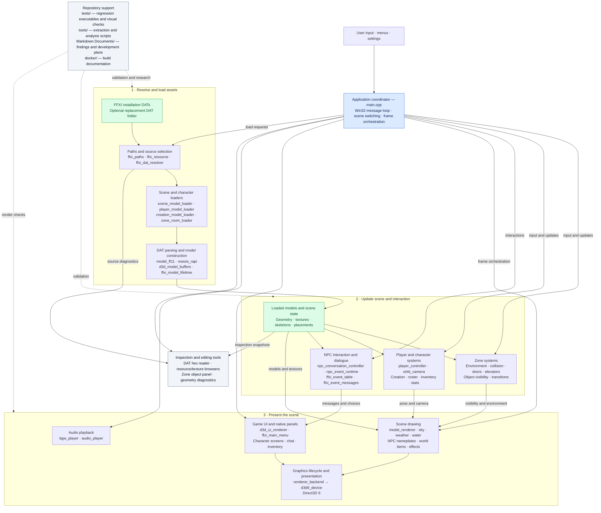

# DATura codebase map

Based on the working tree inspected on October 8, 2026. Boxes group related modules; arrows show coordination or data flow, rather than an exhaustive include graph.

The central architectural fact is that `main.cpp` coordinates many extracted modules and still owns substantial application behavior. The three groups above are conceptual responsibilities within the application, not separate services.

Start with `main.cpp` for control flow, `scene_model_loader.cpp` and `model_ff11.cpp` for asset loading, and `model_renderer.cpp` for drawing. `renderer_backend.h` exposes a graphics lifecycle wrapper, but the current model renderer and loaders use the Direct3D 9 device directly.

The DAT resolver selects physical replacement files while retaining retail logical paths. The hex reader operates on an editable buffer and saves new copies. Research checkouts under `tmp/` and the LandSandBoat source/data trees are supporting material; this diagram does not imply that DATura runs a networked game server.
